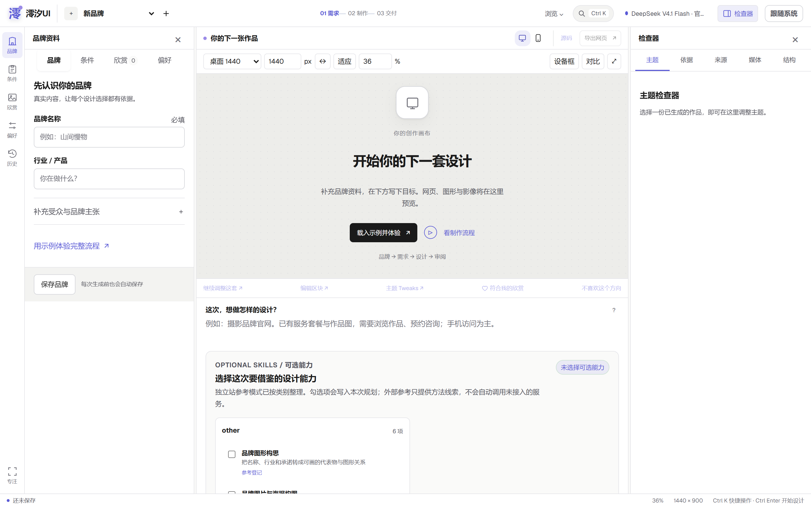
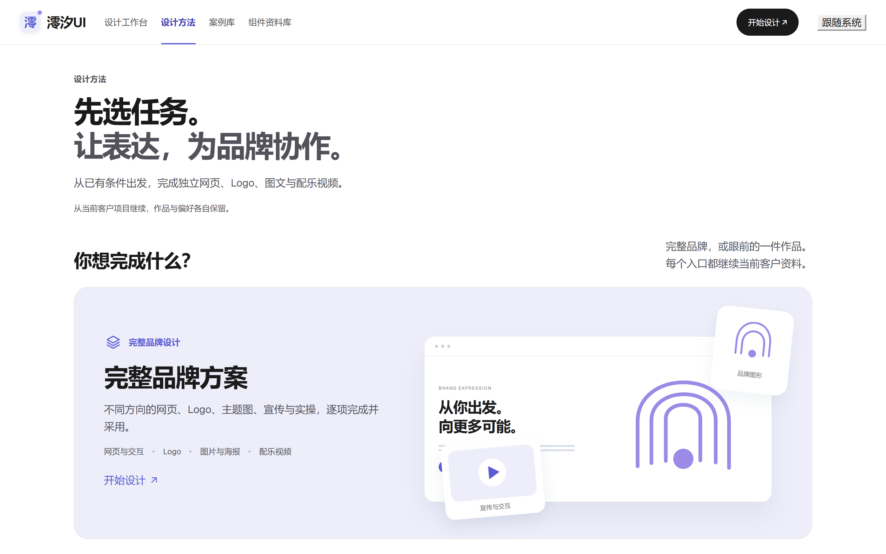
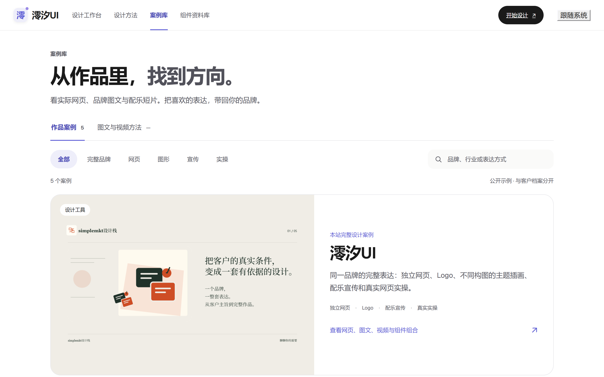

# 澪汐UI · 设计语言层

澪汐UI 是一套**品牌设计栈**：给一份结构化 brief，它把品牌性格映射成可执行的设计语言，检索组件并适配结构，并发出三套骨架不同的多页方案，再交给真实浏览器门禁与看图评审验收后才算完成。

本仓库开源的是这套栈的**语言层**——设计令牌、落地页套件、以及语言层的规则说明。生成内核、组件镜像与客户数据不在本仓库。



## 设计栈的管线

```
品牌 brief（名称 / 行业 / 受众 / 主张 / 已有文案 / 素材）
   ↓
品牌四轴性格：温暖度 · 信息密度 · 克制程度 · 正式程度（越界自动收敛并留痕）
   ↓
设计语言映射：字族 · 字阶比例 · 栅格列数 · 卡片圆角 · 图像处理 · 动效强度 · 版面密度
   ↓
区块职责检索 → 组件结构适配（作用域隔离 · 动画重命名 · 内容替换 · 素材挂载）
   ↓
三套骨架并行：品牌叙事 / 鲜明主张 / 从容日常（方案间版式差异设下限，不足重排）
   ↓
事实溯源校验（价格、数量、比例、评价追溯不到来源即标「待补充」，不编造）
   ↓
真实浏览器门禁（路由可达 · 移动端 · 键盘焦点 · 减少动画降级）
   ↓ 不通过不进交付
截图看图评审（版面节奏 / 层级 / 色彩 / 内容真实性 / 品牌契合度）→ 结论回写区块
   ↓
导出 index.html · DESIGN.md · tokens.css · manifest.json
```

## 本仓库有什么

| 路径 | 内容 |
| --- | --- |
| `tokens/tokens.css` | 设计令牌单一来源。明暗双主题暴露同一套完整契约，含间距节奏、圆角档位、语义色角色与焦点环 |
| `kit/landing-kit/` | 落地页套件，零依赖：`landing-kit.css` + `landing-kit.js` + `liquid-ripple.js`（WebGL2 稳定流体，`prefers-reduced-motion` 自动退化为静态渐变） |
| `kit/landing-kit/demo.html` | 套件的完整示例页，改文案即可用 |
| `docs/design-language.md` | 语言层规则：四轴性格如何落到具体数值，以及哪些判断必须交给人 |
| `docs/screenshots/` | 工作台、案例库、设计方法页实拍 |

产品实拍（品牌名已统一为澪汐UI）：设计方法页与案例库页。





## 快速开始

ES module 与 WebGL 需要 HTTP 环境，直接双击打开会被浏览器拦住：

```bash
python3 -m http.server 8080
# 打开 http://127.0.0.1:8080/kit/landing-kit/demo.html
```

只想要令牌，直接引 CSS：

```html
<link rel="stylesheet" href="tokens/tokens.css">
```

`landing-kit.css` 为了能单独分发，自带一组局部变量，不依赖 `tokens.css`；两者可以共存——`tokens.css` 定义产品面的统一契约，套件只负责自己那部分的取值。

主题由 `:root` 与 `[data-theme="dark"]` 两套变量控制，切换只改根节点属性，不重排布局。

## 不在本仓库的内容

| 项 | 原因 |
| --- | --- |
| `components/` 组件镜像 | 约三千余条来自公开 UI 库与参考站，版权归原作者，按各自许可分发，不在本仓库重新分发 |
| 生成内核与验收管线 | 品牌参数化、方案编排、浏览器门禁、看图评审的实现，闭源 |
| 品牌与客户数据 | 任何客户的品牌资料、作品与素材都不进入代码仓库 |

因此本仓库可以直接拿来用，但不能拼出完整的澪汐UI；需要完整能力请通过工作台使用。

## 许可

代码与文档：MIT，见 [LICENSE](LICENSE)。

字体不在本仓库分发。若引用 Inter，请遵循其 OFL-1.1 许可自行获取。
