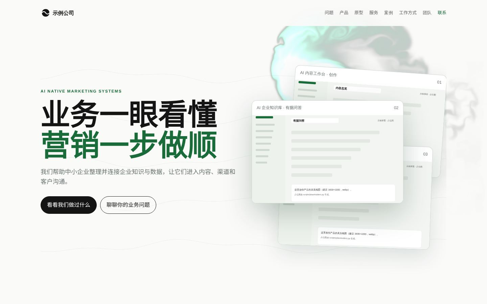
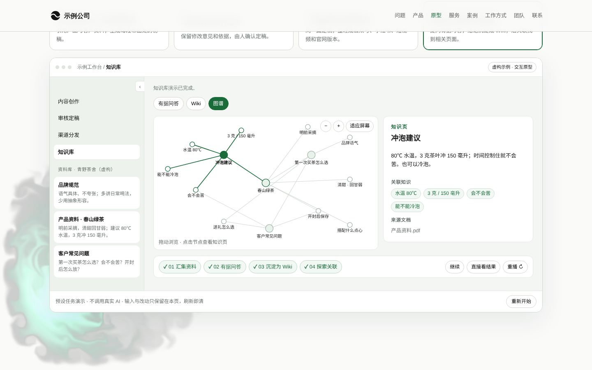

# 澪溪UI · 公司官网模板（带可操作的产品原型）

一个零依赖的单文件公司官网模板：暖白纸感、WebGL 流体氛围背景、按访客问题组织的区块，以及一个**访客可以亲手点的产品原型**。所有文案、案例、团队、联系方式都是示例占位，换成你自己的内容即可上线。



## 里面有什么

| 区块 | 交互 |
| --- | --- |
| 首屏 | 流体波纹背景（独立实现的 WebGL2 稳定流体，`prefers-reduced-motion` 自动退化为静态渐变） |
| 问题 | 翻转卡片，键盘可操作 |
| 产品 | 浏览器框截图 + 页签，每个页签有自己的说明，视口内自动轮播，点一下即停，可放大 |
| **产品原型** | 任务卡驱动的原型窗口：有据初稿（引用可回跳出处）、审核定稿、一稿多渠道扇形轮播、知识图谱（SVG，可拖动缩放、点节点看知识页）。每个演示都有 播放 / 暂停 / 直接看结果 / 重播 |
| 服务 | 选择器 + URL hash 可分享，相关案例直接打开抽屉 |
| 案例 | 筛选、抽屉、上一个 / 下一个、← → 、滑动、焦点管理 |
| 团队 / 联系 | 翻转卡、一键复制 |
| 导航 | scrollspy、手机菜单点链接自动收起、滚动揭示带兜底 |



原型的交互规则写在 [docs/product-demo-interactions.md](docs/product-demo-interactions.md)：11 种模式的结构、状态机、键盘、退化和验收。

## 使用

1. 直接打开 `index.html`，或者起一个静态服务：`python3 -m http.server 8080`。
2. 全局搜索「示例」「占位」，把以下内容换成你自己的：
   - 导航与页脚的 logo（现在是一个内联 SVG 占位标）
   - `<title>`、`meta description`
   - 首屏主张、问题卡、产品说明
   - 产品截图：`media/product/*.svg` 换成真实界面图（建议 1600×1000 的 webp，文件名保持不变）
   - 原型里的示例品牌「青野茶舍」与资料内容（HTML 里搜 `pw-tile`、`PAGES`、`cases`）
   - 案例数组 `const cases=[...]` 与 `media/cases/`
   - 团队与 `media/team-*.svg`、联系方式与二维码
3. 跑一遍验收：

```bash
npm i -D playwright && npx playwright install chromium
python3 -m http.server 8080 &
node scripts/qa.mjs http://127.0.0.1:8080/index.html
```

验收会检查：控制台报错、裂图、390 宽横向溢出、滚动揭示是否全部出现、原型四条路由与播放器、轮播方向键、图谱标签重叠、减少动画下直接显示结果，并在 `scripts/out/` 留下截图。

## 规则

模板自带几条「做客户站不翻车」的约定，建议保留：

- 演示里出现的品牌、人物、数字必须是虚构或经客户确认的，并且**在画面上**标明「示例 / 虚构」。
- 演示不发网络请求、不调模型、不发送；输入只保留在本页，刷新即清。
- 无脚本时每个演示直接显示最终状态；`prefers-reduced-motion` 下不自动播放。
- 中文标题按行拆分，避免单字孤行；手机端 `section-head` 上下排列。
- 页面里出现的每个数字都要能在源材料里找到出处。

## 技术

- 单文件 HTML，无构建、无框架、无第三方脚本；字体从 Google Fonts 加载（Noto Serif SC / Noto Sans SC），断网时退回系统字体。
- 主题变量在 `:root`（`--green --ink --paper --line --muted --serif --sans`），改色只改这里。
- 流体背景参数在 `<main data-options>`：`colors intensity force radius simRes dyeRes pressureIters maxDpr`；整页铺满时建议 `simRes 96 / dyeRes 320 / maxDpr 1`。

## 许可

代码以 MIT 许可发布（见 `LICENSE`）。模板中的占位图形与示例文案可随意替换；「澪溪UI」名称与标识不在授权范围内。

由 澪溪UI 整理发布。
